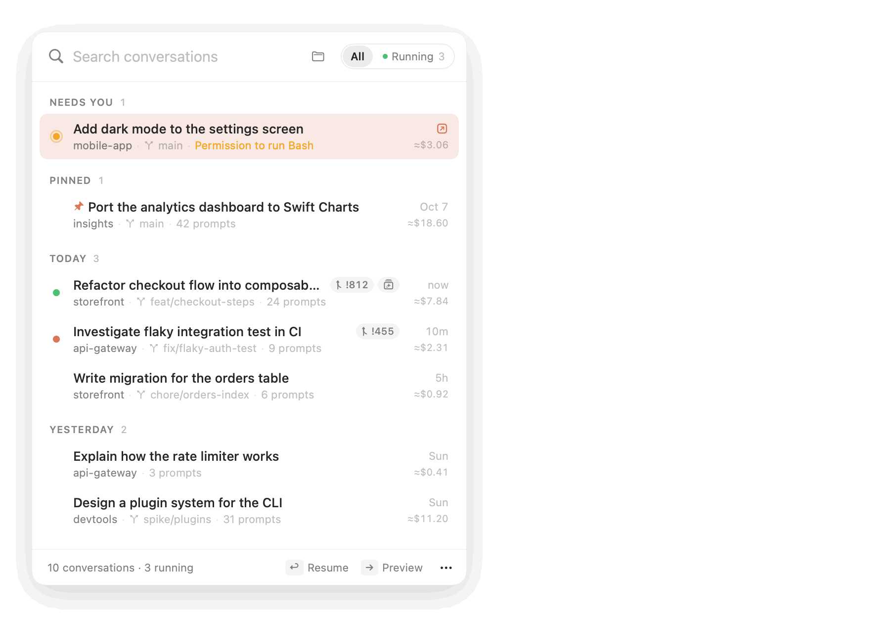
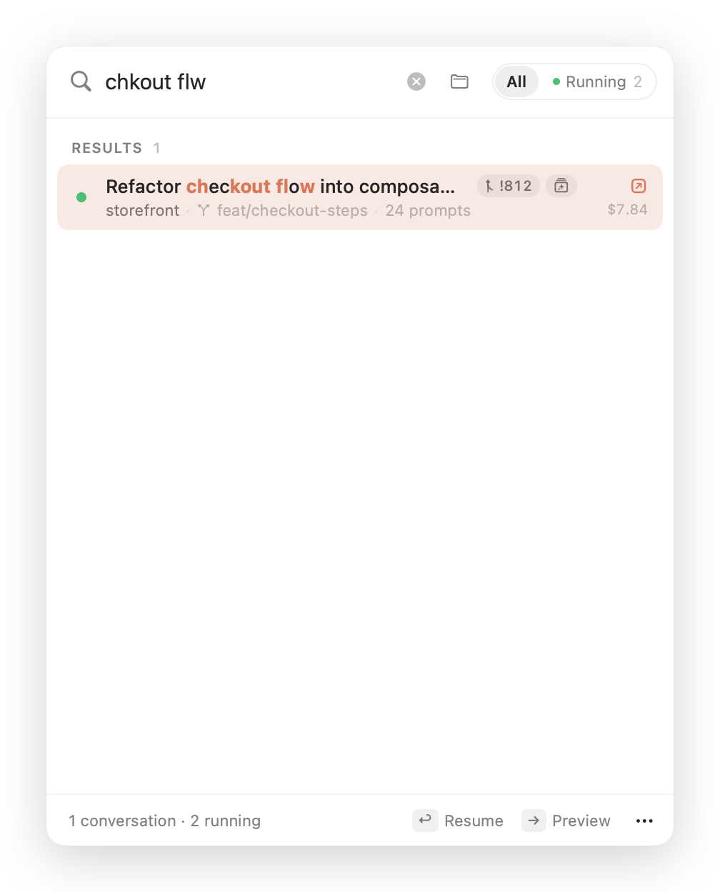
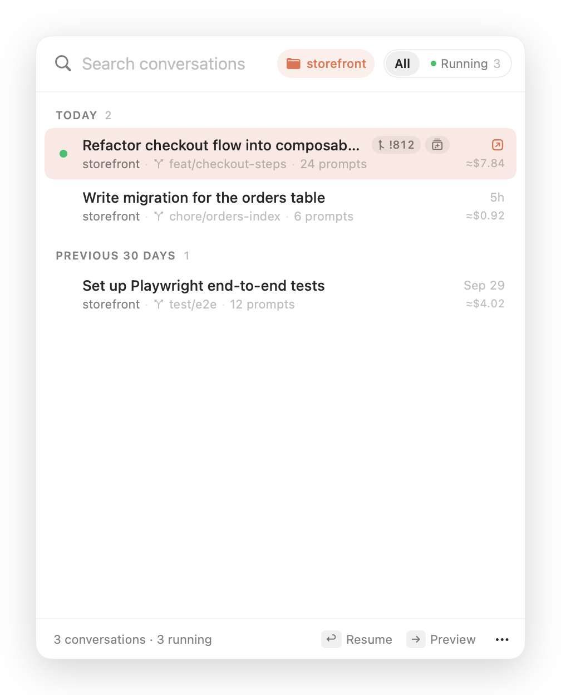
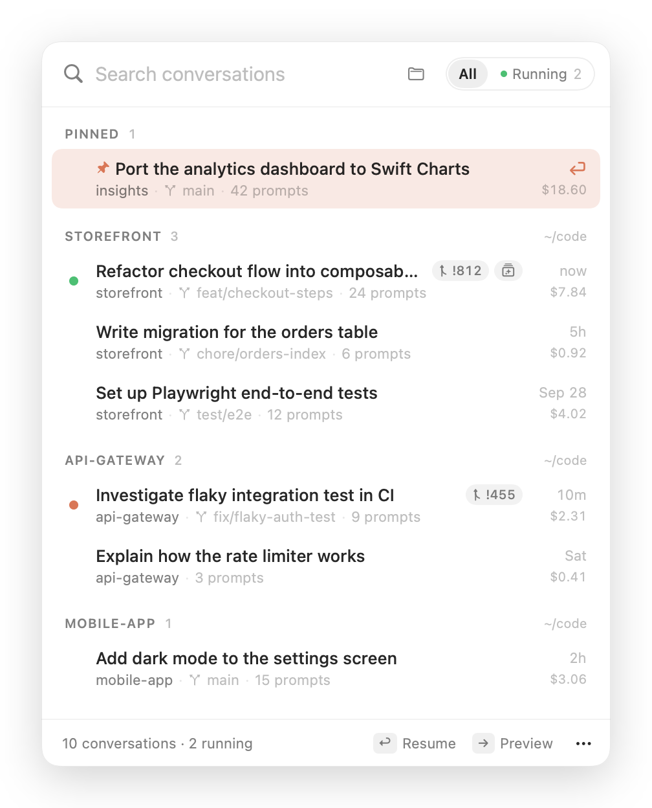
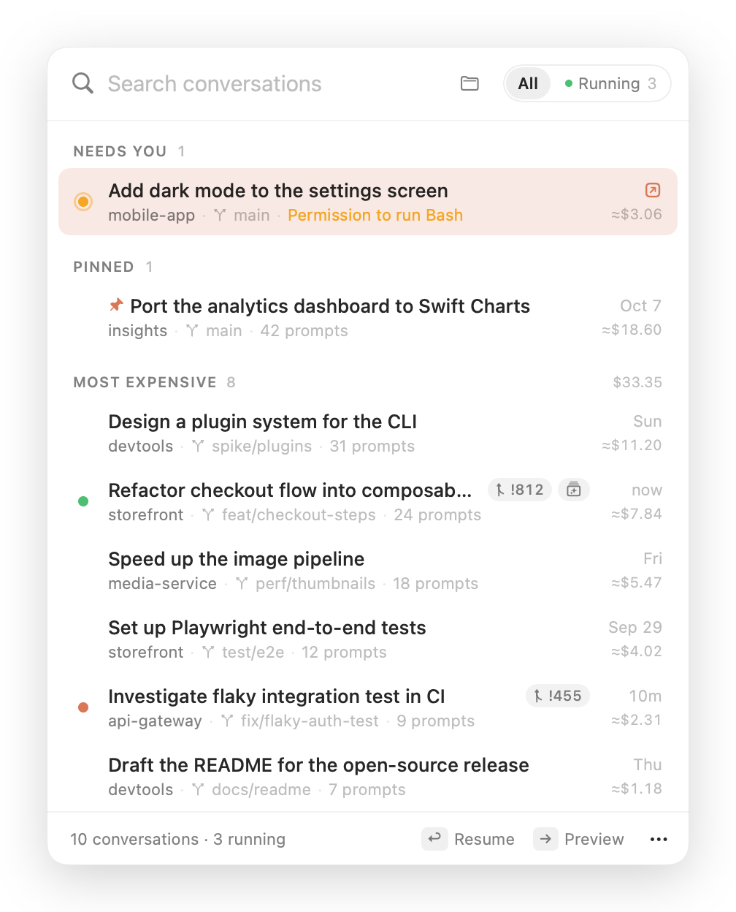
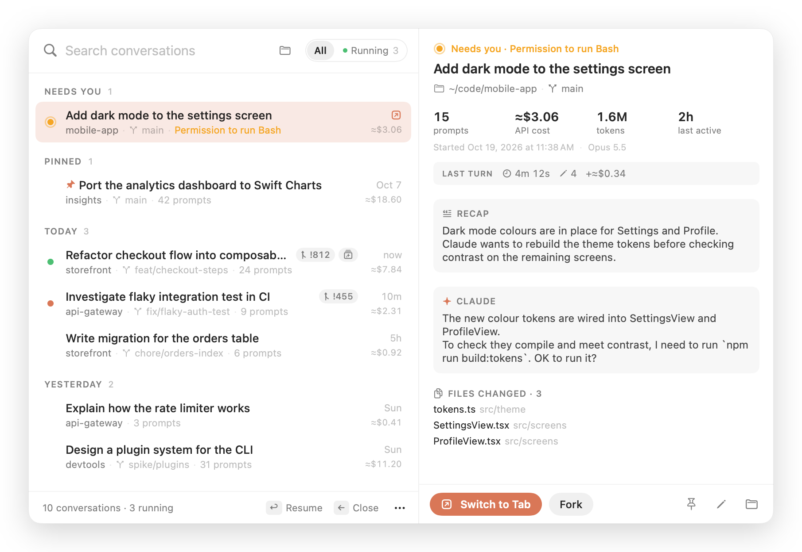
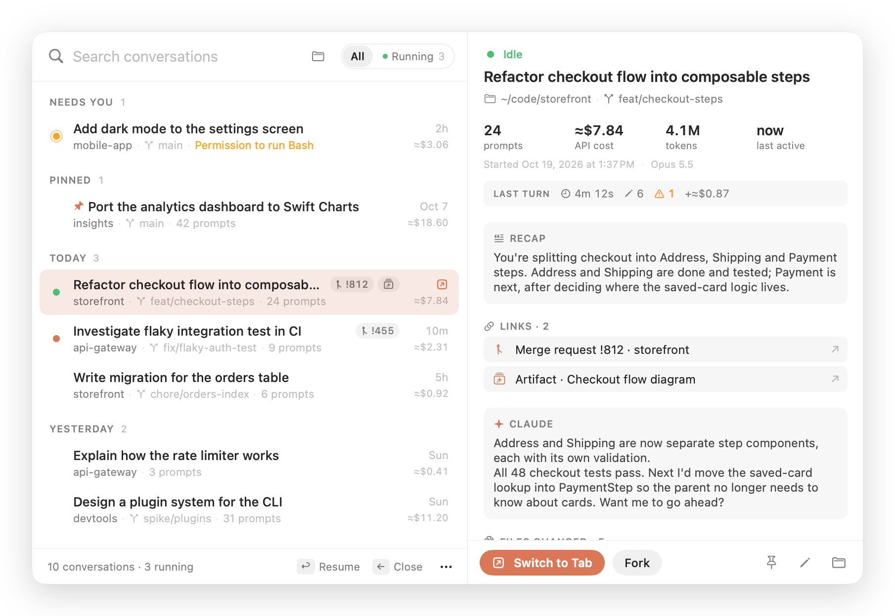

<div align="center">


# ClaudeResume

**Every Claude Code conversation, one click from coming back.**

A native macOS menu bar app that lists your Claude Code sessions, shows which ones are still
running, and resumes any of them in iTerm2 or Ghostty, in the right folder, with one click.


<picture>
  <source media="(prefers-color-scheme: dark)" srcset="docs/demo-dark.gif">
  
</picture>

<sub>All screenshots and the demo use made-up data, rendered with <code>make screenshots</code>.</sub>

</div>

## Why

`claude --resume` only shows sessions from the folder you're in, so you need to remember
where a conversation happened before you can find it. With a dozen repositories and a few
long-running sessions, you end up with lots of iTerm2 tabs and no idea which one is working,
which one is waiting for you, or what the one from last Tuesday was about.

ClaudeResume puts every conversation from every project in one searchable list, one shortcut
away. Pick one and you're back in it.

## Features

### Find it

- **Every conversation in one place.** Sessions from all your projects, grouped into Today,
  Yesterday, Previous 7 days, Previous 30 days and then by month. You can also group them by
  **project** or by **cost**.
- **Readable titles.** Your `/rename` name, else the title Claude generated, else your first
  prompt. Each row also shows the folder, git branch, prompt count, age and cost.
- **Search as you type.** It matches titles, prompts, recaps, folders, branches, changed files,
  links and session IDs, with the matches highlighted.
  - Every word has to match somewhere.
  - Loose matches work: `frmw upd` finds "Firmware update".
  - Accents and Turkish letters are ignored: `calis` finds "çalışıyor".
- **Project filter.** The folder button narrows the list to one repository.

<table>
  <tr>
    <td width="50%">
      <picture>
        <source media="(prefers-color-scheme: dark)" srcset="docs/screenshot-search-dark.png">
        
      </picture>
    </td>
    <td width="50%">
      <picture>
        <source media="(prefers-color-scheme: dark)" srcset="docs/screenshot-project-dark.png">
        
      </picture>
    </td>
  </tr>
  <tr>
    <td align="center"><sub>Loose search with highlighted matches</sub></td>
    <td align="center"><sub>Filtered to one project</sub></td>
  </tr>
  <tr>
    <td width="50%">
      <picture>
        <source media="(prefers-color-scheme: dark)" srcset="docs/screenshot-projects-dark.png">
        
      </picture>
    </td>
    <td width="50%">
      <picture>
        <source media="(prefers-color-scheme: dark)" srcset="docs/screenshot-cost-dark.png">
        
      </picture>
    </td>
  </tr>
  <tr>
    <td align="center"><sub>Grouped by project</sub></td>
    <td align="center"><sub>Grouped by cost, with the total</sub></td>
  </tr>
</table>

### Get back in

- **One-click resume.** Clicking a row opens a new terminal tab, or window, and runs
  `cd <folder> && claude --resume <id>`.
  - iTerm2 is the default. Choose Ghostty in **⋯ → Terminal** to use Ghostty 1.3 or later.
    Ghostty uses your configured shell, including its `PATH` and credentials.
  - If iTerm2 isn't open yet, it uses the window iTerm2 opens at launch, so there's no empty
    extra tab.
- **Running sessions get focused, not duplicated.** iTerm2 tabs are matched by the process's
  terminal, including sessions you started by hand. Ghostty can focus sessions opened by
  ClaudeResume. A session in another terminal must be switched to there or quit before resuming.
  Changing the terminal setting affects new launches; existing sessions keep their own terminal.
- **Fork** (<kbd>⌥↩</kbd>) continues a conversation as a new one (`--fork-session`).
- **Extra flags** such as `--model opus` can be added to every resume.

### Know what's happening

- **Needs you.** When Claude is blocked on a permission prompt or a question, the session moves
  to a **Needs you** section at the top, with an amber dot and the reason, for example
  "Permission to run Bash". The menu bar icon gets an amber dot too, so you can see it from any app.
- **Live status.** A coral pulse means Claude is working, green means it's idle, and amber means
  it needs you. **All | Running** (<kbd>⇥</kbd>) shows only the open sessions. The menu bar icon
  gets a dot while any session is working.
- **Notifications.** You get one when Claude needs your input, and one when a turn that took
  longer than 20 seconds ends. The second shows what the turn did, for example
  *"4m 12s · 6 edits · +≈$0.84"*, and the start of Claude's reply. Clicking either takes you to
  that tab. If that tab is already in front of you, there's no notification.

<picture>
  <source media="(prefers-color-scheme: dark)" srcset="docs/screenshot-needs-you-dark.png">
  
</picture>
- **Preview** (<kbd>→</kbd>). A side pane shows the session without resuming it:
  - the last turn: how long it took, edits, tool errors and what it cost
  - Claude's latest recap and your last prompt
  - the start of Claude's last reply
  - the files it edited
  - its merge requests and artifacts
  - prompt count, cost, tokens and models
- **Merge requests and artifacts.** Pull or merge requests and published artifacts a session
  created appear as chips on the row. Click a chip to open it.
- **Cost per session.** The API-equivalent cost at list prices, subagents included. Estimates
  are marked `≈`. A figure without `≈` is Claude Code's own recorded total.

<picture>
  <source media="(prefers-color-scheme: dark)" srcset="docs/screenshot-dark.png">
  
</picture>

### Keep it tidy

- **Pin** (<kbd>⌘P</kbd>) the conversations you keep coming back to.
- **Hide** (<kbd>⌘⌫</kbd>) the ones you're done with. They stay on disk, and you can bring
  them back from the ⋯ menu.
- **Rename** (<kbd>⌘E</kbd>). This writes the same line `/rename` writes, so `claude --resume`
  shows the new name too.
- **Quit idle sessions.** Stop every session that has waited for input for over a day, three
  days, a week or a month. You can also close their terminal tabs at the same time. The
  conversations stay saved, and busy sessions are never touched.

### Stay out of the way

- **Native and small.** AppKit and SwiftUI, no dependencies, about 4 MB, and a universal binary.
- **No network access.** No analytics, no update checks, no telemetry. Everything is read
  from files on your Mac.
- **Incremental.** After the first scan, only transcripts that changed are read again.

## Install

### Download

1. Get `ClaudeResume-vX.Y.Z.zip` from the [latest release](../../releases/latest) and unzip it.
2. Move `ClaudeResume.app` to `/Applications` (or `~/Applications`) and open it.
3. The app is ad-hoc signed, not notarised, so macOS blocks it the first time. Either
   right-click the app → **Open**, or run:
   ```sh
   xattr -dr com.apple.quarantine /Applications/ClaudeResume.app
   ```

### Build from source

Requires Xcode 16 or later (Swift 6).

```sh
git clone <this repository>
cd claude-resume
make install   # builds ClaudeResume.app, copies it to ~/Applications and launches it
```

### First launch

The panel opens once by itself so you can see where the app lives in the menu bar. After
that, click the icon or press <kbd>⌃⌥R</kbd>.

macOS asks for two permissions, each the first time it's needed:

| Permission | Asked when | Used for |
| --- | --- | --- |
| **Automation → iTerm2 / Ghostty** | you first use that terminal | opening, focusing and closing its tabs |
| **Notifications** | at launch | "Claude finished" notifications (optional) |

No Accessibility, Screen Recording or Full Disk Access permission is needed.

## Requirements

- macOS 15 Sequoia or later, on Apple silicon or Intel.
- [iTerm2](https://iterm2.com) (default), or [Ghostty](https://ghostty.org) 1.3 or later
  with `macos-applescript` enabled.
- [Claude Code](https://claude.com/claude-code), with `claude` on the `PATH` of your selected terminal's shell.

## Keyboard shortcuts

| Key | Action |
| --- | --- |
| <kbd>⌃⌥R</kbd> | Open or close the panel from anywhere (can be turned off) |
| <kbd>↑</kbd> <kbd>↓</kbd> | Move through the list |
| <kbd>↩</kbd> | Resume, or show the running session's tab |
| <kbd>⌘↩</kbd> | Resume in a new window |
| <kbd>⌥↩</kbd> | Fork into a new conversation |
| <kbd>→</kbd> / <kbd>←</kbd> | Open or close the preview |
| <kbd>⇥</kbd> | Switch between All and Running |
| <kbd>⌘1</kbd> <kbd>⌘2</kbd> <kbd>⌘3</kbd> | Group by date, project or cost |
| <kbd>⌘P</kbd> | Pin or unpin |
| <kbd>⌘E</kbd> | Rename |
| <kbd>⌘⌫</kbd> | Hide or unhide |
| <kbd>⌘C</kbd> | Copy the resume command (when no text is selected) |
| <kbd>⌘R</kbd> | Refresh |
| <kbd>esc</kbd> | Clear the search, close the preview, or close the panel |

Right-click a row for the same actions, plus copying the session ID, opening the folder, showing
the transcript in Finder, opening links, and quitting a running session.

## Settings

Click **⋯** in the panel's footer:

- **Group By**: date, project or cost.
- **Terminal**: iTerm2 (default) or Ghostty.
- **Open Sessions In**: a new tab or a new window.
- **Extra claude Flags**: added to every resume command, for example `--model opus`.
- **Notify When Claude Finishes**
- **Show Hidden Conversations**
- **Global Shortcut ⌃⌥R**
- **Launch at Login**
- **Quit Idle Sessions**: waiting for over 1, 3, 7 or 30 days.

## How it works

ClaudeResume reads what Claude Code already keeps on disk:

| What | Where it comes from |
| --- | --- |
| Conversations | `~/.claude/projects/<project>/<session>.jsonl` |
| Titles, prompts, folder, branch | `custom-title`, `ai-title` and `user` entries in each transcript |
| Recaps | `away_summary` entries, Claude's "while you were away" summaries |
| Merge requests, artifacts | `pr-link` and `frame-link` entries |
| Files changed | `Edit`, `Write`, `MultiEdit` and `NotebookEdit` tool calls |
| Tokens, cost | `usage` blocks in the session and its `subagents/` transcripts, priced in `Pricing.swift` |
| Running sessions: working, idle or needing you | `status` and `waitingFor` in `~/.claude/sessions/<pid>.json`, checked every 3 seconds |
| The last turn | everything after your latest prompt, plus its `turn_duration` entry |
| A session's iTerm2 tab | the process's terminal (`sysctl`), matched against each iTerm2 session's `tty` |
| An app-launched Ghostty terminal | an inherited launch marker, mapped to Ghostty's surface ID |
| Opening, focusing, closing tabs | native AppleScript to the session's terminal |

Transcripts can be hundreds of megabytes, mostly tool output. The parser never decodes a whole
transcript:
- It only decodes lines whose first bytes mark them as a title, prompt, link or recap.
- For responses, it reads the model and `usage` block straight from the bytes.
- Each response is counted once, even though Claude Code logs it once per content block.
- Each file is cached by size and modification date.

**Last activity** comes from message timestamps, not file dates. Claude Code sometimes rewrites
old transcripts, which makes their file dates unreliable.

**Cost** is what the tokens would cost at the
[API list prices](https://platform.claude.com/docs/en/about-claude/pricing), including cache
writes, cache reads and fast mode. When Claude Code recorded its own total for a session, the
larger of the two is shown, because that total can be older than the transcript. If you're on
a subscription, read it as what the session would have cost through the API, not what you paid.

## Privacy

- **Nothing leaves your Mac.** The app makes no network requests. Links you click open in your
  browser.
- **Read-only, with three exceptions, all ones you trigger:**
  - Renaming a stopped session appends one `custom-title` line to its transcript, exactly like
    `/rename`.
  - Quitting a session sends its Claude Code process `SIGTERM`. If you asked for it, it then
    closes the terminal tab.
  - Your pins, hidden sessions and settings are stored in the app's own preferences.
- **Renaming a running session** shows the new name right away, and writes it to the
  transcript only once the session has stopped. Claude Code keeps the title in memory and would
  overwrite it.

## Troubleshooting

| Problem | Fix |
| --- | --- |
| *"Allow ClaudeResume to control iTerm2…"* or *"…Ghostty…"* banner | Turn on that terminal in **System Settings → Privacy & Security → Automation → ClaudeResume**. If you built from source, macOS may ask again after a rebuild, because the ad-hoc signature changes. |
| The tab opens but says `claude: command not found` | `claude` isn't on your selected terminal shell's `PATH`. Check with `which claude` in a new tab. |
| *"… no longer exists"* | The session's folder was moved or deleted. `claude --resume` needs to run in the original folder, so move it back, or copy the session ID from the right-click menu. |
| A running session cannot be focused | iTerm2 can locate manually started sessions by tty. ClaudeResume can match Ghostty sessions it opened itself. Switch to the session's terminal, or quit it first. |
| Ghostty automation fails | Use Ghostty 1.3 or later and enable `macos-applescript` in its configuration. |
| No notifications | Allow them for ClaudeResume in **System Settings → Notifications**. Turns shorter than 20 seconds don't notify. |
| Two notifications per turn | Another Claude Code notification hook or plugin is also active. Keep one of them. |
| A session is missing | Sessions without a prompt you typed are skipped, for example ones that only ran a hook. **Show Hidden Conversations** brings back hidden ones. |

Claude Code's transcript format isn't a public API and can change between versions. If titles,
links or costs stop showing up after a Claude Code update, please
[open an issue](../../issues/new/choose).

## Development

```sh
make test         # Swift Testing suite: parser, search, store, commands
make run          # run from the terminal
make dump         # print every session the app would list, with cost and links
make app          # build build/ClaudeResume.app
make screenshots  # re-render docs/screenshot-*.png and docs/demo*.gif from demo data
make icon         # regenerate Resources/AppIcon.icns
```

Some debugging commands:
- `ClaudeResume --resume <id-prefix>` resumes or focuses a session without the UI.
- `ClaudeResume --snapshot out.png [--demo] [--dark] [--preview] [--query text] [--group project]`
  renders the panel to an image.
- `ClaudeResume --gif out.gif [--dark]` renders the animated demo.

Tagging `vX.Y.Z` builds a universal binary and publishes a GitHub release. See
[CONTRIBUTING.md](CONTRIBUTING.md) for how the code is organised.

## Related

[ClaudeBar](https://github.com/nurettincoban/claude-usage-bar) is a separate app from the same
author. It shows your Claude plan limits and usage in the menu bar.

## Disclaimer

ClaudeResume is an unofficial community project. It is not affiliated with, endorsed by, or
supported by Anthropic. It reads Claude Code's local files, whose format may change without
notice. "Claude" is a trademark of Anthropic, PBC. iTerm2 is a separate project by George Nachman.

## License

[MIT](LICENSE) © 2026 Nurettin Coban
